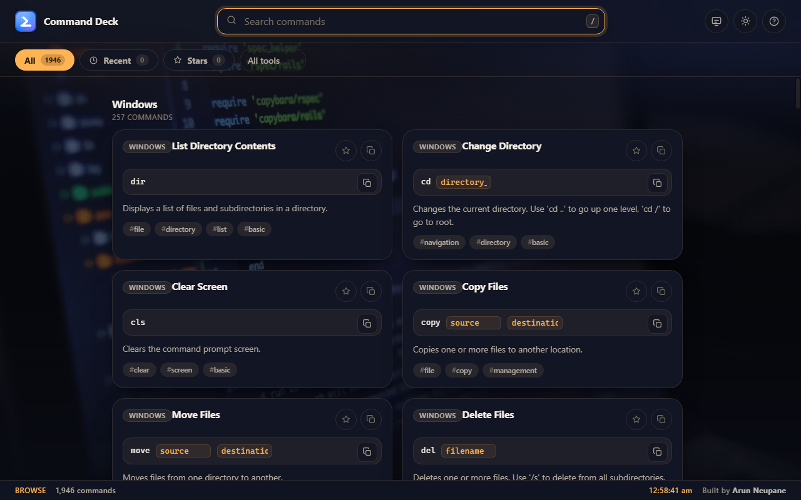
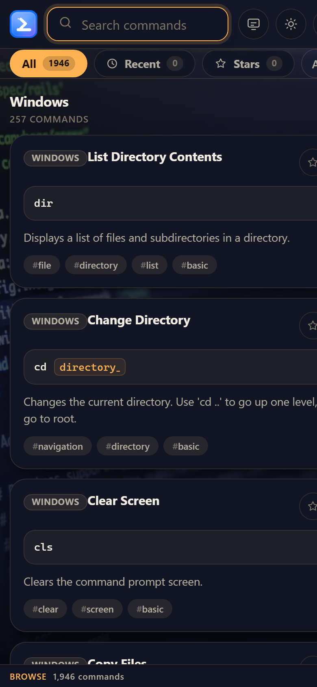

# Command Deck

A single-file command reference that federates nine tool collections into one searchable, copy-friendly app. Opens straight from disk, works fully offline, and feels like a native iOS app.

Built with plain HTML, CSS, and JS. The shipped artifact is one self-contained `index.html` (all styles, scripts, fonts, and data inlined), so it runs from `file://` with zero dependencies and zero network calls.





## What's inside

- **1,946 commands across 9 tool sets**: Windows, macOS, Linux, Git, npm, pnpm, VS Code, Next.js, DaVinci Resolve
- **Spotlight-style search** with operators:
  - `@git` locks a tool set
  - `#setup` filters a tag
  - `"exact phrase"` forces contiguous matches
  - `-word` drops results
- **Copy in one gesture**: click or tap a card, or focus it with the keyboard and press Enter. Result is copied to the clipboard and briefly flashes
- **Inline placeholder filling**: commands with `<placeholder>` arguments render editable fields, and the copy uses the filled values
- **Per-card actions**: copy, fill variants, star, and "More" (expand the note)
- **Chips**: All, Recent, Stars, with live counts
- **Tool select** in the toolbar to jump to a whole tool set
- **Command palette** (`Mod+K`) with search plus quick actions
- **Custom context menus**: on cards and on the page itself
- **4 themes**: Daylight, Graphite, Night Shift, and Auto (follows your OS)
- **Settings sheet** (`Mod+,`): dense mode, usage counts, reduce motion, sound, haptics, and remappable shortcuts
- **Persistent in `localStorage`**: favorites, recents, use counts, settings
- **Global hotkeys** (when not typing): `A` all tools, `S` stars, `R` recents, `/` focus search, `Shift+/` help, `Mod+K` palette, `Mod+,` settings, `Mod+Shift+T` theme, `Mod+Shift+F` favorites
- **Custom not-found state** for unknown `#routes`

## Getting started

1. Open `index.html` in any modern browser (Chrome, Edge, Firefox, Safari).
2. That's it. No install, no server, no build step at runtime.

To reset local data (favorites, settings, recent history): open Settings and choose "Reset all data".

## Development

Source lives in `src/index.template.html` with a data placeholder; the command data is federated from `commands/*.json` at build time. Edits to the template require a rebuild.

```bash
node scripts/build.mjs            # federalize data, emit index.html
node tests/validate.mjs           # 7 checks: schema, embed sync, core logic
node "C:\Users\arunn\.claude\skills\impeccable\scripts\detect.mjs" index.html --viewport 1280x800
```

Notes:

- Never modify anything under `commands/`; it is the owned upstream dataset.
- The command data is embedded via a compact dictionary serializer (about 4 to 5 times smaller than raw JSON).
- `index.html` is a build artifact; hand edits are overwritten on the next build.

## Project layout

```
commands/                 upstream JSON collections (9 tool sets, read only)
scripts/core.mjs          federation, normalization, grouping, serialization, search scoring
scripts/build.mjs         build pipeline (template + data to index.html)
tests/validate.mjs        node validation suite
src/index.template.html   the app: design system, components, interactions, data placeholder
rules/tracker.md          progress tracker
PRODUCT.md                product record and constraints
plan.md                   build plan
LICENSE                   MIT
```

## Console easter eggs

Open DevTools and type: `help`, `whoami`, `neofetch`, `github`, `secret`, `hire`, `cls`.

## Credits

- Fonts: Space Grotesk and JetBrains Mono, embedded under the SIL Open Font License 1.1.
- Night Shift wallpaper: photograph from Pexels (free license), used as an ambient layer in dark themes.

## License

MIT. See `LICENSE`.